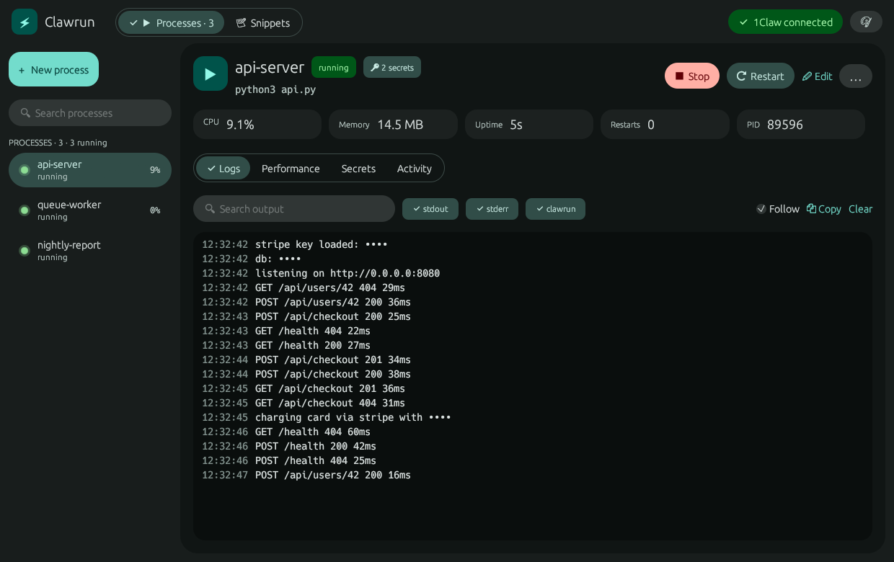
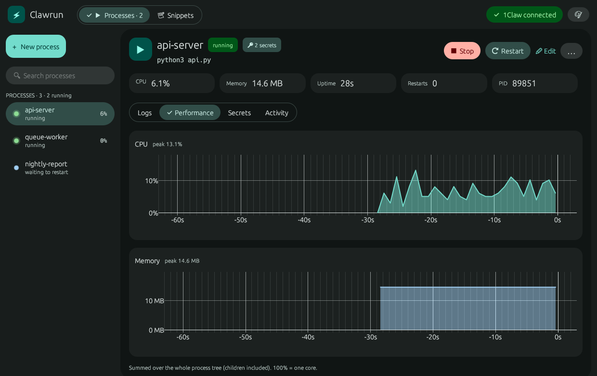
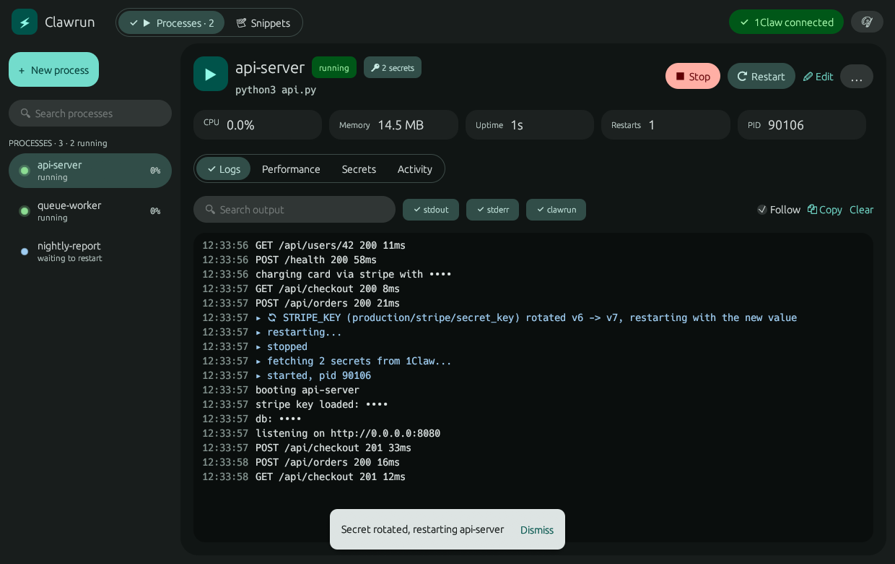
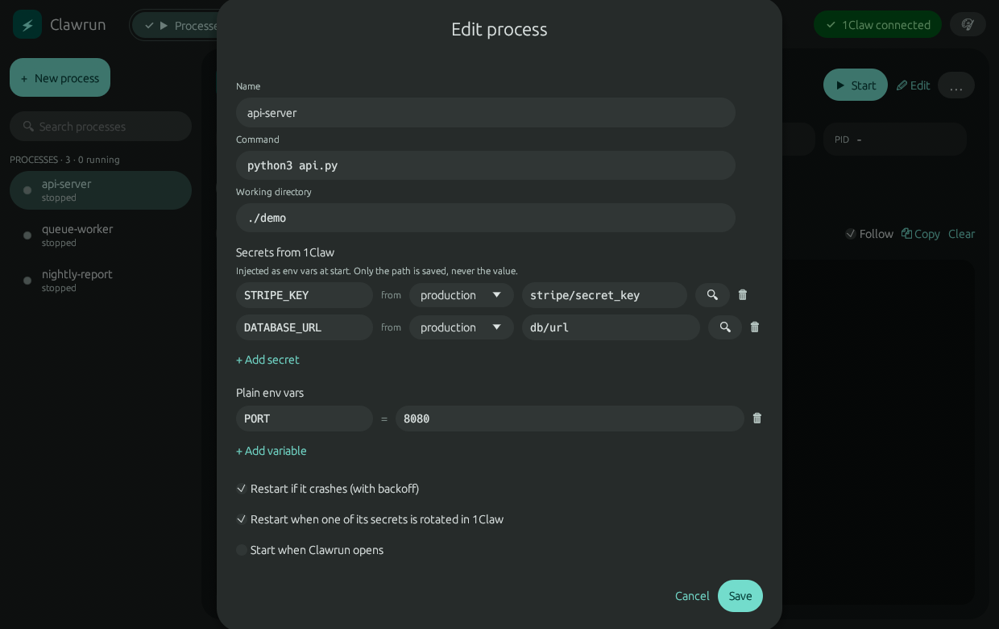
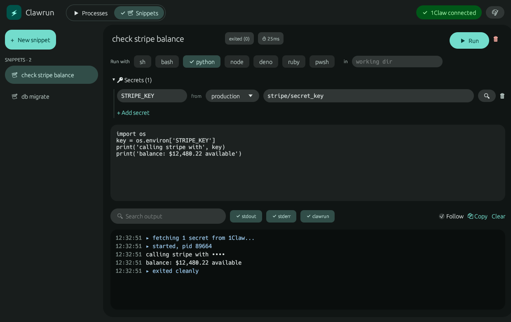
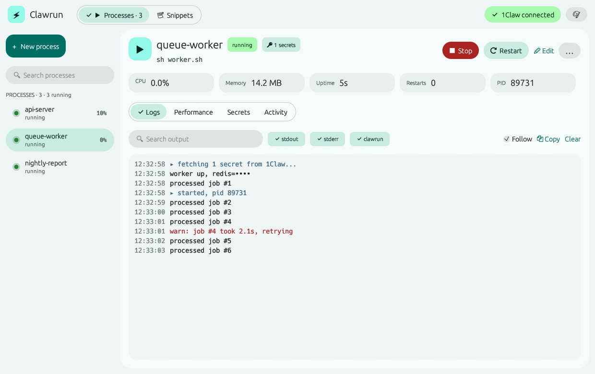

# Clawrun

A desktop process manager that injects [1Claw](https://1claw.co) secrets into your apps, with live logs, performance graphs and a snippet runner.

Think pm2 with a window, where nothing ever reads a `.env` file. Written in Rust with egui, and it uses the same Material You look as [1claw-vault-explorer](https://github.com/Codrax/1claw-vault-explorer).



## What it does

- **Secrets from 1Claw, not `.env` files.** Each process lists the secrets it needs, like `STRIPE_KEY ← production / stripe/secret_key`. They're fetched when the process starts and passed only to that process's environment. Nothing is written to disk.
- **Masked output.** If a secret value ever shows up in stdout or stderr, it's replaced with `••••` before it reaches the screen. Multi-line secrets like keys and certs are masked line by line.
- **Restart on rotation.** Clawrun checks your vaults every 30 seconds. When a secret a running process uses gets a new version, that process restarts with the new value. The check only lists secret metadata, so it doesn't add read events to your audit log.
- **Process control.**
  - Start, stop and restart.
  - Stopping takes down the whole process tree (process groups on unix). It sends SIGTERM first and SIGKILL if the process hasn't exited after 4 seconds.
  - Optional auto-restart on crash, with backoff (1s, 2s, 4s… up to 30s). It gives up after 8 crashes in a minute.
- **Live logs.** stdout, stderr and Clawrun's own messages each get a colour. You can filter and search, follow the tail, or copy the log (already masked). Colour codes are stripped.
- **Performance graphs.** CPU and memory for the whole process tree, one sample a second, plus tiles for uptime, restarts and PID.
- **Activity.** Shows the 1Claw audit events for the secrets each process uses.
- **Snippet runner.** One-off scripts (sh, bash, python, node, deno, ruby, pwsh) with secrets injected. Press Ctrl+Enter to run. Output and exit time appear in place.
- **Committable config.** Process definitions only store secret *paths*, never values, so the project file is safe to commit.
- **Material You theme.** Pick from seven seed colours, in light or dark.

## Screenshots

| | |
|---|---|
|  |  |
| CPU / memory of the process tree | A secret rotated in 1Claw, so the process restarts with the new value |
|  |  |
| Mapping env vars to vault paths | Running a one-off script with a secret |
|  | |
| Light mode | |

*(the screenshots run real local processes against a fake 1Claw server, so no real keys appear)*

## Running it

```sh
cargo run --release
```

Hit **Connect 1Claw** and paste a personal key (`1ck_...`) or an agent key (`ocv_...`). Tick *Remember me* to stay connected. Processes that don't use any secrets work without connecting.

You can also skip the dialog:

```sh
ONECLAW_API_KEY=ocv_xxx cargo run --release
```

### Project files

Processes and snippets live in `~/.config/clawrun/clawrun.json` (or the equivalent folder on other platforms). To use a project file next to your code instead, pass it on the command line:

```sh
clawrun ./clawrun.json
```

[`examples/clawrun.json`](examples/clawrun.json) shows the format.

Settings live in `settings.json` in the same folder: base URL, theme, rotation interval, and the key if you ticked *Remember me*. On unix that file is `0600`.

### Linux deps

```sh
sudo apt install libxkbcommon-dev libgl1-mesa-dev libwayland-dev
```

## Layout

```
src/
  supervisor.rs  spawning, process groups, log capture + masking, stop/restart/backoff
  metrics.rs     cpu/mem sampling summed over the process tree
  app.rs         state, 1Claw connection, secret fetching, rotation watch
  ui_procs.rs    processes tab (logs, graphs, secrets, activity, editor)
  ui_snippets.rs snippet runner
  api.rs         1Claw REST client (shared with vault-explorer)
  theme.rs       Material You palette + widgets (shared with vault-explorer)
  config.rs      settings + project file
```

## Notes

- Masking works on exact values (4+ characters). If a program prints a secret transformed, for example base64 or URL-encoded, it won't be caught.
- Each start reads its secrets, so every start shows up as `secret.read` in your 1Claw audit log. That's intended.
- Processes get `stdin` closed and `PYTHONUNBUFFERED=1` so Python output streams live. Most other runtimes are fine already. Some tools buffer when they're not attached to a terminal.

MIT licensed.
